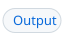
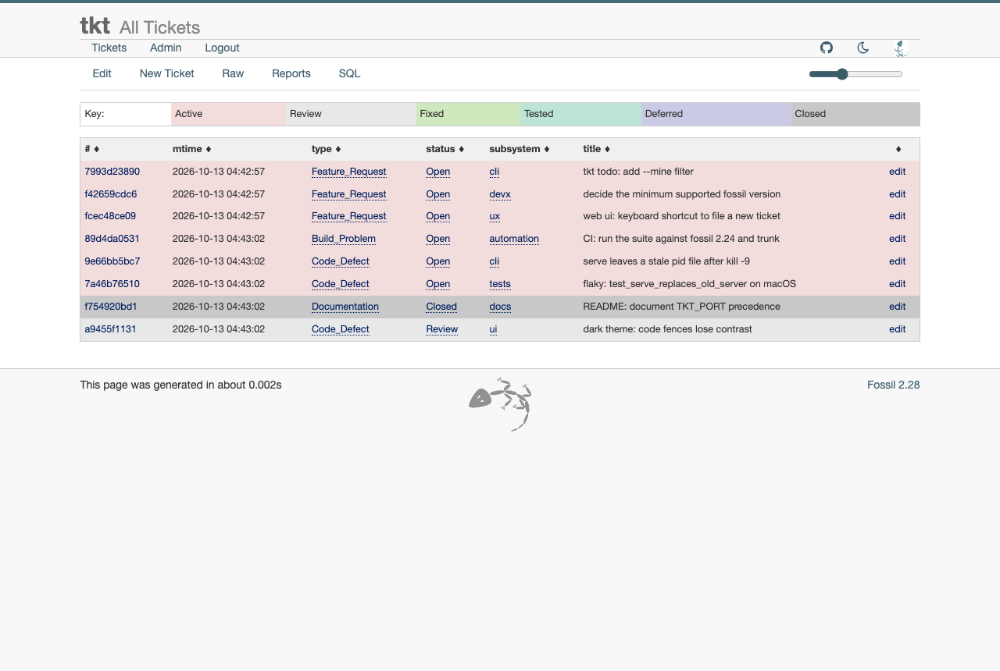
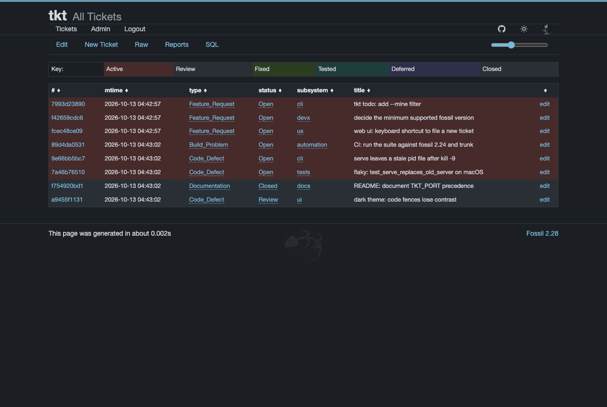
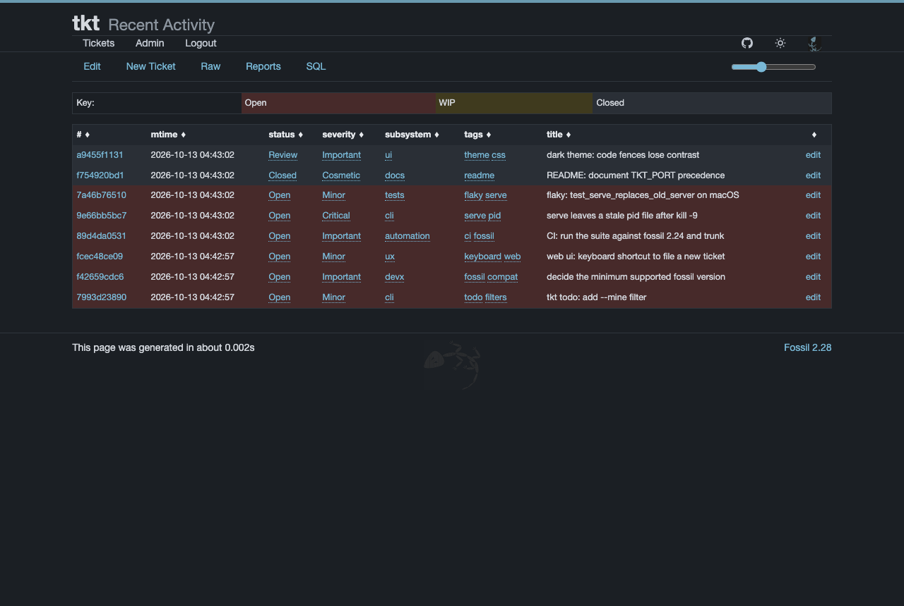
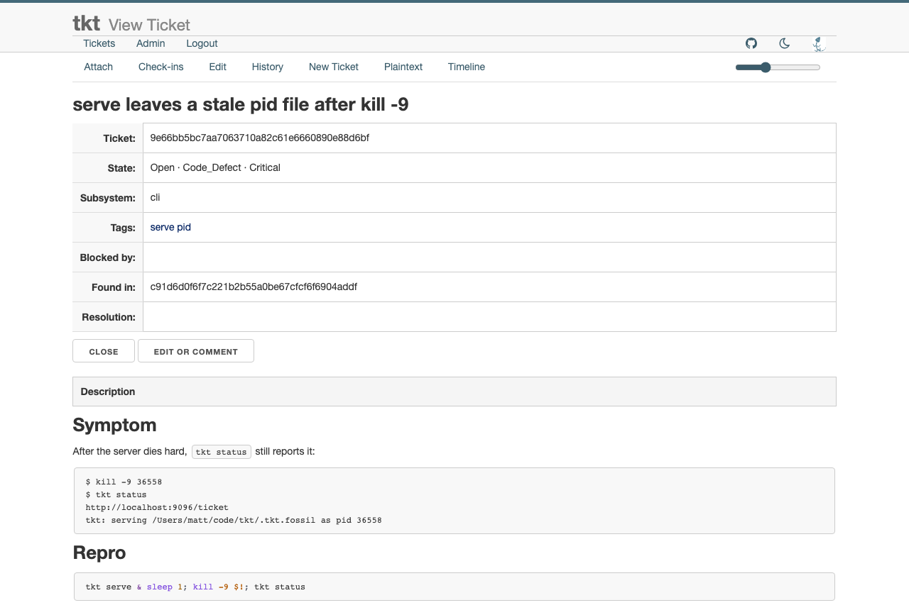
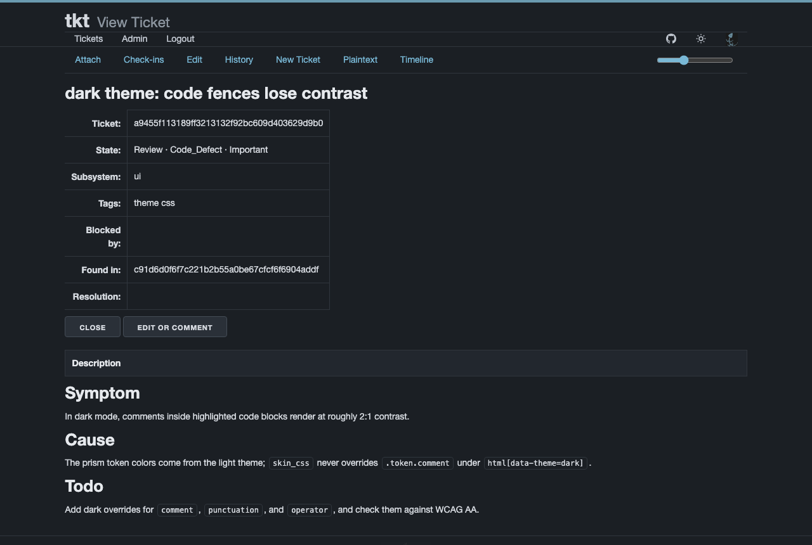
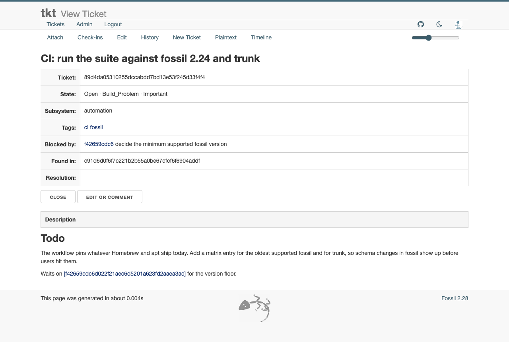
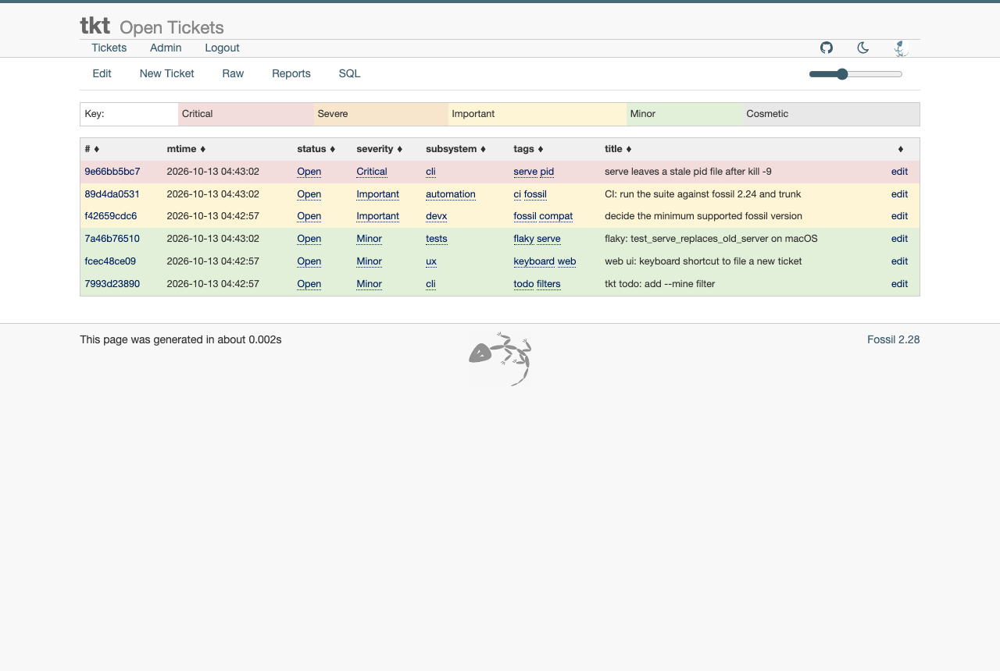
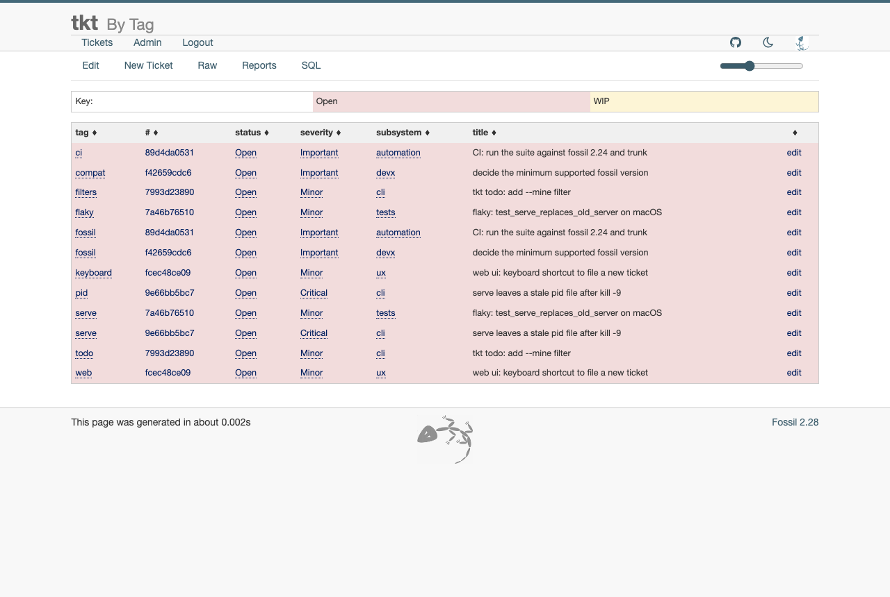
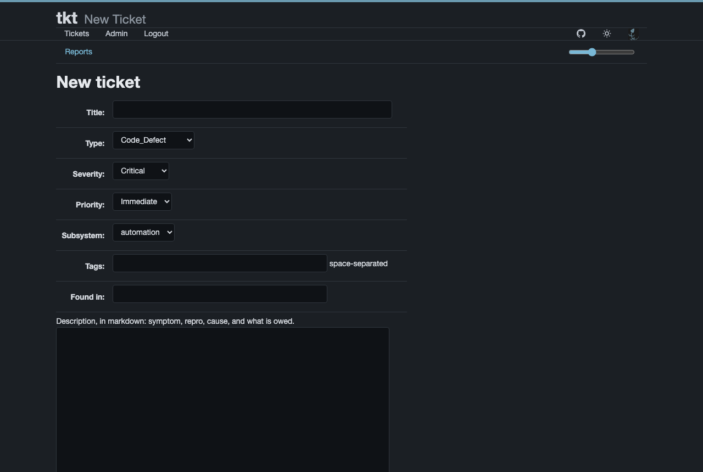

<!-- header tkt "tkt" | Why #why | Install #install | Config #config | Usage #usage | Web UI #web-ui | Agents #agents | Dev #dev -->
<p align="right"><a id="tkt"></a><a href="#tkt"><picture><source media="(prefers-color-scheme: dark)" srcset="docs/img/hdr/readme.tkt.title.dark.svg"></picture></a><a href="#why"><picture><source media="(prefers-color-scheme: dark)" srcset="docs/img/hdr/readme.tkt.0.dark.svg"></picture></a><a href="#install"><picture><source media="(prefers-color-scheme: dark)" srcset="docs/img/hdr/readme.tkt.1.dark.svg"></picture></a><a href="#config"><picture><source media="(prefers-color-scheme: dark)" srcset="docs/img/hdr/readme.tkt.2.dark.svg"></picture></a><a href="#usage"><picture><source media="(prefers-color-scheme: dark)" srcset="docs/img/hdr/readme.tkt.3.dark.svg"></picture></a><a href="#web-ui"><picture><source media="(prefers-color-scheme: dark)" srcset="docs/img/hdr/readme.tkt.4.dark.svg"></picture></a><a href="#agents"><picture><source media="(prefers-color-scheme: dark)" srcset="docs/img/hdr/readme.tkt.5.dark.svg"></picture></a><a href="#dev"><picture><source media="(prefers-color-scheme: dark)" srcset="docs/img/hdr/readme.tkt.6.dark.svg"></picture></a><br clear="all"><picture><source media="(prefers-color-scheme: dark)" srcset="docs/img/hdr/_rule.dark.svg"></picture></p>
<!-- /header -->

<p><picture><source media="(prefers-color-scheme: dark)" srcset="docs/img/icon-dark.svg"></picture>
&nbsp;&nbsp; a small alternative front-end to <a href=https://fossil-scm.org>fossil's</a> built-in <a href=https://fossil-scm.org/home/doc/trunk/www/bugtheory.wiki>bug tracker</a>.</p>

Fossil's great! A single-file tool, uses SQL under the hood, and the tracker supports a simple CLI / a Web UI / markdown out of the box.

**But!** If you're only interested in the tracker and not the rest of the version-control capabilities.. the interface is too large, and Fossil's default workflow model and UX are [kind of weird](#why), and `tkt` can help.

```bash
# CLI
tkt init
cat repro.md | tkt new title='widget explodes' tags='compiler oop'
tkt list
tkt show 896eb890

# Query by recents, or severity
tkt todo 5
tkt triage 5

# Read-only SQL
echo "select status, count(*) as n from ticket group by status;" | tkt sql

# Optional Web UI
tkt serve
```

See [Usage](#usage) for more, but you get the idea.  Ideal for ultralight in-project or offline usage by human(s). Also ideal for [agents](#agents), who are already bash / SQL natives anyway. 

This is about as simple as it gets.  One tool, many workflows, no hassle with auth or APIs.  Track the DB to share tickets with other devs.  Ignore the DB for a private local, no clutter on jira/github issues.  You can even use it *per task* for complex work that needs more structure than a TODO list.. and then just throw away the tracker when you're done.

<!-- header why "Why" | The Big One #the-big-one | The Other Ones #the-other-ones -->
<p align="right"><a id="why"></a><a href="#why"><picture><source media="(prefers-color-scheme: dark)" srcset="docs/img/hdr/readme.why.title.dark.svg"></picture></a><a href="#the-big-one"><picture><source media="(prefers-color-scheme: dark)" srcset="docs/img/hdr/readme.why.0.dark.svg"></picture></a><a href="#the-other-ones"><picture><source media="(prefers-color-scheme: dark)" srcset="docs/img/hdr/readme.why.1.dark.svg"></picture></a><br clear="all"><picture><source media="(prefers-color-scheme: dark)" srcset="docs/img/hdr/_rule.dark.svg"></picture></p>
<!-- /header -->

Fossil isn't buggy, but it's weird, and more like a framework than a solution.  It *is* however very flexible, so that even a humble script like `tkt` can use it as a backend and present a different model.  

Here's the stuff we're trying to work-around.

### The Big One

By default, actual ticket-status in fossil is buried in an append-only log.  The `New Ticket` form saves the problem statement as the ticket's first comment.  Major corrections to the ticket's actual *spec* later  appear as basically more comments.  Current status shouldn't mean replaying / reconciling a log-stream, who knows what `shun` is supposed to mean!? =P 

Instead, `tkt` adds a `description` field that is replaced in place. Running `tkt edit` rewrites it, comments stay append-only beside it, and every earlier version of the description stays in fossil's change history. Nothing is shunned, and a ticket always reads as its current statement.

### The Other Ones

<table>
<tr><th width="50%">Fossil</th><th width="50%"><code>tkt</code></th></tr>
<tr><td>No tags, and no dependencies between tickets</td><td>Adds <code>tags</code> and <code>blockers</code> fields. <code>tkt block</code> checks each id as it is written, <code>tkt show</code> derives what a ticket blocks, and prose references come from fossil's own backlink index</td></tr>
<tr><td>No command shows one ticket: <code>fossil ticket show</code> dumps a whole report as tab-separated text</td><td>The <code>tkt show</code>, <code>list</code>, and <code>search</code> verbs print markdown, cross-references included</td></tr>
<tr><td>The <code>fossil ticket</code> command line fails silently: a missing <code>mimetype</code> renders the body as plain text, an empty value is dropped so clearing does nothing, a one-word value such as <code>-q</code> is taken as a fossil option, and one <code>+</code> character separates append from replace</td><td>Every verb sets the mimetype, clears by writing a space, refuses option-like values before calling fossil, and chooses append or replace itself</td></tr>
<tr><td>The web ui is a whole version-control site: timeline, files, wiki, and bug tracker.  Many UX issues with the tracker, regardless of theme.</td><td>Tracker only. Landing page is tickets, menu is trimmed, many improvements for skin and UX, including syntax highlighting. Ticket detail page is *normal*, with Close/Reopen/Edit/Tags.</td></tr>
<tr><td>The <code>fossil server</code> command listens on every network interface</td><td>Only localhost is served, one server per tracker, and a new <code>serve</code> takes over from the old one</td></tr>
<tr><td>Installing a custom ticket setup rewrites whichever repository it is pointed at</td><td>The <code>init</code> verb refuses a repository that is not already a tkt tracker, unless given <code>--adopt</code></td></tr>
</table> 

<a id="install"></a>
## Install

You need fossil and bash, available in any package manager.  Then just put `tkt` somewhere on your path.

```bash
# Download it, make executable.
curl -fsSL -o ~/.local/bin/tkt \
  https://raw.githubusercontent.com/mattvonrocketstein/tkt/main/tkt
chmod +x ~/.local/bin/tkt

# Or, from a clone of this repo
make install
```

<!-- header config "Config" | Tracker #location | Environment #env | Existing Repos #existing-repos -->
<p align="right"><a id="config"></a><a href="#config"><picture><source media="(prefers-color-scheme: dark)" srcset="docs/img/hdr/readme.config.title.dark.svg"></picture></a><a href="#location"><picture><source media="(prefers-color-scheme: dark)" srcset="docs/img/hdr/readme.config.0.dark.svg"></picture></a><a href="#env"><picture><source media="(prefers-color-scheme: dark)" srcset="docs/img/hdr/readme.config.1.dark.svg"></picture></a><a href="#existing-repos"><picture><source media="(prefers-color-scheme: dark)" srcset="docs/img/hdr/readme.config.2.dark.svg"></picture></a><br clear="all"><picture><source media="(prefers-color-scheme: dark)" srcset="docs/img/hdr/_rule.dark.svg"></picture></p>
<!-- /header -->

<a id="location"></a>

### Tracker Location

The tracker is one fossil repository file, `.tkt.fossil`. `tkt` uses the first of:

1. `TKT_DB`, when set.
2. The nearest `.tkt.fossil` in the current directory or any parent.
3. A new `.tkt.fossil` at the git root, when inside a git repository.
4. A new `.tkt.fossil` in the current directory.

So `tkt` works the same without git, and from any subdirectory once the tracker exists. In a git repository, ignore the tracker and the files beside it:

```bash
echo '.tkt.fossil*' >> .gitignore
tkt init
```

The `tkt init` command is idempotent and also migrates: when `tkt` gains a field, every verb refuses with the field name until you run `tkt init` again.

<a id="env"></a>

### Environment

| Variable | Default | Purpose |
| --- | --- | --- |
| `TKT_DB` | The nearest `.tkt.fossil` | Tracker file |
| `TKT_USER` | `$USER` | Admin user created by `init` |
| `TKT_PORT` | `9080` | Port for `serve`; the environment wins, else a `TKT_PORT=` line in `.env` beside the tracker |
| `NO_COLOR`, `NOCOLOR` | Unset | Any value turns off color on a terminal |

<a id="existing-repos"></a>
### Existing Fossil Repositories

Running `tkt init` replaces a repository's ticket schema, ticket view page, and main menu, and gives anonymous users read access. That is right for a tracker and wrong for a fossil repository you use for anything else, so `init` only modifies a repository that is already a tkt tracker. It recognizes one by a `tkt-version` row in the repository's `config` table, which `init` writes, or by the `blockers` column that only the tkt ticket schema has.

For any other repository `init` refuses and says what it would replace. To turn an existing repository into a tracker anyway:

```bash
TKT_DB=project.fossil tkt init --adopt
```

<!-- header usage "Usage" | Tour #tour | Verbs #verbs | Fields #fields | Descriptions #descriptions | Cross-Refs #xrefs | SQL #sql | Output #output | Limits #limits -->
<p align="right"><a id="usage"></a><a href="#usage"><picture><source media="(prefers-color-scheme: dark)" srcset="docs/img/hdr/readme.usage.title.dark.svg"></picture></a><a href="#tour"><picture><source media="(prefers-color-scheme: dark)" srcset="docs/img/hdr/readme.usage.0.dark.svg"></picture></a><a href="#verbs"><picture><source media="(prefers-color-scheme: dark)" srcset="docs/img/hdr/readme.usage.1.dark.svg"></picture></a><a href="#fields"><picture><source media="(prefers-color-scheme: dark)" srcset="docs/img/hdr/readme.usage.2.dark.svg"></picture></a><a href="#descriptions"><picture><source media="(prefers-color-scheme: dark)" srcset="docs/img/hdr/readme.usage.3.dark.svg"></picture></a><a href="#xrefs"><picture><source media="(prefers-color-scheme: dark)" srcset="docs/img/hdr/readme.usage.4.dark.svg"></picture></a><a href="#sql"><picture><source media="(prefers-color-scheme: dark)" srcset="docs/img/hdr/readme.usage.5.dark.svg"></picture></a><a href="#output"><picture><source media="(prefers-color-scheme: dark)" srcset="docs/img/hdr/readme.usage.6.dark.svg"></picture></a><a href="#limits"><picture><source media="(prefers-color-scheme: dark)" srcset="docs/img/hdr/readme.usage.7.dark.svg"></picture></a><br clear="all"><picture><source media="(prefers-color-scheme: dark)" srcset="docs/img/hdr/_rule.dark.svg"></picture></p>
<!-- /header -->

<a id="tour"></a>
### Quick Tour

```bash
# file one, with tags
cat repro.md | tkt new title='widget explodes' tags='compiler oop'

# correct the statement of the problem, leaving the discussion alone
cat rewritten.md | tkt edit 896eb890

# add to the discussion
printf 'Reproduced on 4.4.1 as well, see [a39d7663e6].\n' | tkt comment 896eb890

# find it again
tkt search widget
tkt list tag=compiler

# newest open tickets, or only the most severe ones
tkt todo
tkt triage -f json

# change one field
tkt set 896eb890 severity Critical

# close it
printf 'Fixed in abc1234, pinned by test_widget.\n' | tkt close 896eb890

# everything else.. just use sql.
tkt sql --schema
tkt sql "select substr(tkt_uuid,1,10) as id, title from ticket where status = 'Open';"
```

For the browser, see [Web UI](#web-ui).

<a id="verbs"></a>
### Verbs

| Verb | Purpose |
| --- | --- |
| `tkt init [--adopt]` | Create the tracker and install its schema and view page; idempotent |
| `tkt new title=... [field=value...]` | File a ticket; stdin becomes the markdown description |
| `tkt show <id>` | One ticket as markdown: title, fields, description, comments, cross-references |
| `tkt list [status=...] [tag=...]` | Markdown table; Open and WIP by default, `status=all` for everything |
| `tkt search <text>` | Case-insensitive substring across titles, descriptions, and comments |
| `tkt todo [N] [--triage] [-f FMT]` | The N newest open tickets, 10 by default, as id, title, severity, subsystem; FMT is `txt`, `md`, or `json` |
| `tkt triage [N] [-f FMT]` | Same as `todo --triage`: only the top severity present among open tickets |
| `tkt edit <id>` | Replace the description from stdin or `$EDITOR` |
| `tkt comment <id>` | Add a comment from stdin or `$EDITOR` |
| `tkt tag <id> <tag...>` | Replace the tag set; `--clear` empties it |
| `tkt block <id> <id...>` | Replace what the ticket waits on; `--clear` empties it |
| `tkt set <id> <field> [value...]` | Write one other field; the value comes from arguments or stdin |
| `tkt close <id> [resolution=...]` | Close the ticket; stdin is the closing comment; resolution defaults to `Fixed` |
| `tkt clean [--force]` | Purge closed tickets after listing them and asking; `--force` skips the prompt; undo with `tkt run purge undo <id>` |
| `tkt sql <query>` | Read-only sql over the tracker, printed as a markdown table; the query can also come on stdin |
| `tkt sql --schema` | The ticket tables, their conventions, and example queries |
| `tkt serve [port=...]` | The web ui, in the foreground, replacing any server this tracker already has |
| `tkt stop` | Stop the tracker's server, from any terminal |
| `tkt status` | Print the server's url, or fail when none is running |
| `tkt skill [install [--project]]` | Print or install the [Claude Code Skill](#skill) |
| `tkt run <fossil args...>` | Any fossil command against the tracker |

<a id="fields"></a>
### Fields and IDs

The `new` verb takes these fields: `title` (required), `type`, `status`, `severity`, `priority`, `subsystem`, `tags`, and `foundin`, which defaults to the current commit. A misspelled field fails instead of being dropped:

```text
$ tkt new title=x subsytem=core
tkt: unknown field: subsytem (known: title type status severity priority subsystem tags foundin)
```

`tkt init` offers `automation`, `tests`, `docs`, `cli`, `devx`, `ux`, and `ui` as subsystems in the web ui. Change the list under Admin > Tickets > Common; a later `tkt init` keeps your version.

Any unique uuid prefix works as an `<id>`. An ambiguous or unknown prefix fails.

<a id="descriptions"></a>
### Descriptions and Comments

Fossil appends to a ticket field only when its name carries a leading plus. The schema `tkt` installs adds three ordinary fields: `description`, `tags`, and `blockers`. Setting any of them replaces the old value, while `icomment` stays the append-only comment log.

That split is the whole design. A ticket reads as one current statement of the problem, with the discussion beside it. **No verb except `run` shuns an artifact or rebuilds history**, so earlier versions of a description stay reachable:

```bash
tkt run ticket history 896eb890
```

Descriptions and comments are markdown, and the web view renders them as markdown, so tables, fenced code, and links all work.

<a id="xrefs"></a>
### Cross-References

There are two kinds, stored differently.

**Blockers** are a declared relation, held in the `blockers` field as canonical ten-char ids. Only the waits-on direction is stored. `tkt show` derives what a ticket blocks by asking which tickets list it, so the two views cannot disagree. Ids resolve when they are written, so a typo fails immediately instead of leaving a dead reference.

```bash
tkt block 896eb890 a39d7663e6 0991582b19
tkt block 896eb890 --clear
```

**Prose references** are any `[](<uuid>)` in a description or comment. That is markdown link format 8, where the url becomes the display text, so the hash renders as a link. On the way in, `tkt` rewrites a bare `[<uuid>]` into that form. Fossil indexes these references itself, and `tkt show` lists them under `Referenced by`.

Use a prose reference for "see also", and a blocker only when the ticket cannot proceed until the other one closes.

<a id="sql"></a>
### Read-Only SQL

The `tkt sql` verb answers the questions the other verbs don't. It runs fossil's sql shell with `--readonly -safe`, so a query can read the tracker but cannot change it, write files, run commands, or open other databases. A failed query exits nonzero. With no query at a terminal, it opens the same read-only shell interactively.

```bash
tkt sql --schema
tkt sql "select status, count(*) as n from ticket group by status;"
```

Writes still go through the verbs, which record each change in fossil's history. The unrestricted shell is `tkt run sql`, for repairs only.

<a id="output"></a>
### Output

The `show`, `list`, `search`, and `todo` verbs print markdown, and `todo` also takes `-f json` or `-f md` for a header row. On a terminal they add color: status, critical severity, ids, and headings. Color is off when output is piped, when `TERM` is `dumb`, or when `NO_COLOR` or `NOCOLOR` is set, so scripts and agents always get plain text.

<a id="limits"></a>
### Limits

- A value that is a single word starting with a dash, such as `-q`, is refused, because fossil would read it as one of its own options. Multi-word values such as a markdown bullet list are fine.
- The `tkt run` verb passes its arguments to fossil unchanged, destructive commands included. It is the escape hatch, not part of the safe surface.

<!-- header web-ui "Web UI" | Serving #serving | What Init Changes #init-changes -->
<p align="right"><a id="web-ui"></a><a href="#web-ui"><picture><source media="(prefers-color-scheme: dark)" srcset="docs/img/hdr/readme.web-ui.title.dark.svg"></picture></a><a href="#serving"><picture><source media="(prefers-color-scheme: dark)" srcset="docs/img/hdr/readme.web-ui.0.dark.svg"></picture></a><a href="#init-changes"><picture><source media="(prefers-color-scheme: dark)" srcset="docs/img/hdr/readme.web-ui.1.dark.svg"></picture></a><br clear="all"><picture><source media="(prefers-color-scheme: dark)" srcset="docs/img/hdr/_rule.dark.svg"></picture></p>
<!-- /header -->

<a id="gallery"></a>
### Gallery

<table align=center>
<tr><td align="center"><a href="docs/img/shots/index-light.png"></a><br><sub>All tickets, light</sub></td><td align="center"><a href="docs/img/shots/index-dark.png"></a><br><sub>All tickets, dark</sub></td><td align="center"><a href="docs/img/shots/report-activity.png"></a><br><sub>Recent activity</sub></td></tr>
<tr><td align="center"><a href="docs/img/shots/detail-light.png"></a><br><sub>Ticket detail</sub></td><td align="center"><a href="docs/img/shots/detail-dark.png"></a><br><sub>Ticket detail, dark</sub></td><td align="center"><a href="docs/img/shots/detail-blocked.png"></a><br><sub>Blocked ticket</sub></td></tr>
<tr><td align="center"><a href="docs/img/shots/report-open.png"></a><br><sub>Open tickets</sub></td><td align="center"><a href="docs/img/shots/report-tags.png"></a><br><sub>By tag</sub></td><td align="center"><a href="docs/img/shots/new-ticket.png"></a><br><sub>New ticket</sub></td></tr>
</table>

<a id="serving"></a>
### Serving

Running `tkt serve` starts fossil's web server in the foreground. The first line it prints is the url, alone on its line:

```text
$ tkt serve
http://localhost:9080/ticket
```

A second line names the tracker and the server's pid, then fossil's own startup line follows.

Each tracker has at most one server. The command records the server's pid and port in `.tkt.fossil.pid` beside the tracker, and a later `serve`, from any terminal, stops that server before starting its own. `tkt stop` ends it from anywhere, and `tkt status` prints its url. The server listens on localhost only, and requests from localhost are logged in as the admin user.

```bash
tkt serve port=9000
tkt status
tkt stop
```

Every project defaults to port 9080, so serving two projects at once collides. The command checks before it starts and refuses with the port and the ways to change it:

```text
$ tkt serve
tkt: port 9080 is taken, likely by another project's tkt serve; pass port=<n>, or set TKT_PORT in the environment or in /Users/you/proj/.env
```

The port comes from the first of these that is set: `port=` on the command line, `TKT_PORT` in the environment, `TKT_PORT` in a `.env` beside the tracker, then 9080. Give each project its own port once by adding a line to its `.env`, which `tkt` reads as plain `KEY=value` text and never sources:

```bash
echo 'TKT_PORT=9081' >> .env
```

To keep it running without a terminal, background it yourself:

```bash
nohup tkt serve >/dev/null 2>&1 &
```

<a id="init-changes"></a>
### What Init Changes

Running `tkt init` trims the web UI down to a tracker:

| Feature | Behavior |
| --- | --- |
| Home page | The root url goes straight to the ticket list |
| Reports | The ticket home page lists **Open Tickets** colored by severity, **Critical and Severe**, **Recent Activity** for the last 30 days, **By Tag** with one row per tag, **Blocked**, and **Recently Closed**, beside Fossil's own **All Tickets** |
| Skin | Fossil's built-in `blitz`, linked from the header rather than copied, with a dark theme layered on top. **Dark** and **Light** in the menu flip the theme; it starts from the browser's color-scheme preference and the choice is kept in local storage, so it is per browser. A browser that used the old `?skin=` links still holds Fossil's skin cookie, which overrides the repository skin; open any page with `?skin=` once to clear it |
| Ticket view | **Close** or **Reopen**, and **Edit or comment**, open the edit form with the fields already set |
| New ticket form | The body goes to the description, and tags can be set |
| Edit form | Appends a markdown comment, and replaces the description in place |

Blockers stay command-line only, since `tkt block` is what checks the ids.

<!-- header agents "Agents & AI" | Rules for Agents #agent-rules | Claude Code Skill #skill -->
<p align="right"><a id="agents"></a><a href="#agents"><picture><source media="(prefers-color-scheme: dark)" srcset="docs/img/hdr/readme.agents.title.dark.svg"></picture></a><a href="#agent-rules"><picture><source media="(prefers-color-scheme: dark)" srcset="docs/img/hdr/readme.agents.0.dark.svg"></picture></a><a href="#skill"><picture><source media="(prefers-color-scheme: dark)" srcset="docs/img/hdr/readme.agents.1.dark.svg"></picture></a><br clear="all"><picture><source media="(prefers-color-scheme: dark)" srcset="docs/img/hdr/_rule.dark.svg"></picture></p>
<!-- /header -->

You might not know this, but you've already made a deal with your agents.  Either you give them a place to *think into*, or else they will comment-spam a massive amount of chain-of-thought logorrhea into everything they touch.  

Tickets can help, and `tkt` in particular is easy for them to drive.

Most of the things in [Why](#why) are `fossil ticket` traps that report success, so an agent that falls into one never finds out.  Weaker models hit them constantly, but `tkt` keeps mechanics in code, and things work as expected or fails with a message that names the fix.  After the fail-silent traps are gone, the judgement that's left is promptable.

<a id="agent-rules"></a>
### Rules for Agents

- Pass bodies on stdin, never as arguments, so quoting cannot mangle them.
- Use `tkt show <id>` before `tkt edit <id>`, since edit replaces the whole description.
- Run `tkt search` before `tkt new`, so the same problem is not filed twice.
- Start from `tkt todo` or `tkt triage` to pick work, and `tkt show <id>` before touching a ticket.
- Use `tkt sql` for questions the verbs don't answer. It is read-only, so it is always safe to run.
- Leave `tkt run` and `tkt init --adopt` to the human.

<a id="skill"></a>
### Claude Code Skill

See [skills/tkt/SKILL.md](skills/tkt/SKILL.md), which teaches Claude Code how to use `tkt`.  It covers the basics above, plus preferred ticket structure, when to rewrite versus comment, when a ticket may be closed, and how to start the web ui if needed.  The skill ships inside `tkt`, so installing it needs no clone and no second download:

1. Install `tkt` as in [Install](#install), then confirm it runs:

   ```bash
   tkt version
   ```

2. Install the skill for every project, or with `--project` for the current one only:

   ```bash
   tkt skill install
   tkt skill install --project
   ```

   The first writes `~/.claude/skills/tkt/SKILL.md` (under `$CLAUDE_CONFIG_DIR` when that is set). The second writes `.claude/skills/tkt/SKILL.md` at the git root, or in the current directory outside git. Rerun it after upgrading `tkt` to pick up a newer skill.

3. Start a new Claude Code session, so it loads the skill.

With no arguments, `tkt skill` prints the skill instead of installing it. Working from a clone, link the skill directory instead, and `tkt skill install` will refuse to overwrite the link:

```bash
ln -s ~/code/tkt/skills/tkt ~/.claude/skills/tkt
```

<a id="pi-skill"></a>
### Pi Skill

The skill follows the [Agent Skills](https://agentskills.io) format, so [pi](https://pi.dev) (or others) can use the same install. 

Point pi at the Claude Code skills directory in `~/.pi/agent/settings.json`:

```json
{ "skills": ["~/.claude/skills"] }
```

For a `--project` install, use `{ "skills": ["../.claude/skills"] }` in `.pi/settings.json` instead, since that path resolves relative to `.pi`.

<a id="dev"></a>
## Development

| Target | Effect |
| --- | --- |
| `make init` | Create `.venv` with pytest; skipped when it already exists |
| `make build` | Run `make skill`; the script itself needs no build step |
| `make test` | Run the suite in `tests/`, after `init` |
| `make install` | Copy `tkt` to `BINDIR`, `~/.local/bin` by default |
| `make skill` | Copy `skills/tkt/SKILL.md` into `tkt`, so `tkt skill` prints the current version |
| `make clean` | Remove the pytest and bytecode caches; `.venv` stays |
| `make docs.headers` | Regenerate the README section headers and their images in `docs/img/hdr` |
| `make docs.check` | Fail when a section header or its images are out of date; writes nothing |
| `make docs.test` | Run the header tool's tests in `docs/tools`, after `init` |
| `make docs.serve` | Preview the README as github.com renders it at `http://localhost:6419/`; needs `gh` |

A section header is a pair of marker comments that `make docs.headers` fills in with a title and a row of link buttons:

```markdown
<!-- header usage "Usage" | Tour #tour | Verbs #verbs -->
<!-- /header -->
```

Edit the opening marker, never the html between the markers. Run `python3 docs/tools/mdheaders.py --help` for the full syntax.

The suite drives the script's command-line interface against throwaway trackers, and needs `fossil` on your `PATH`. Set `TKT_BASH` to run the script under a specific bash, for example the macOS system shell:

```bash
TKT_BASH=/bin/bash make test
```

The GitHub workflow in `.github/workflows/test.yml` runs the same targets on Linux and macOS.

The skill lives in two places: `skills/tkt/SKILL.md`, and a copy inside `tkt` that `tkt skill` prints. Edit `skills/tkt/SKILL.md`, then run `make skill` to update the copy. `make test` fails when they differ.
